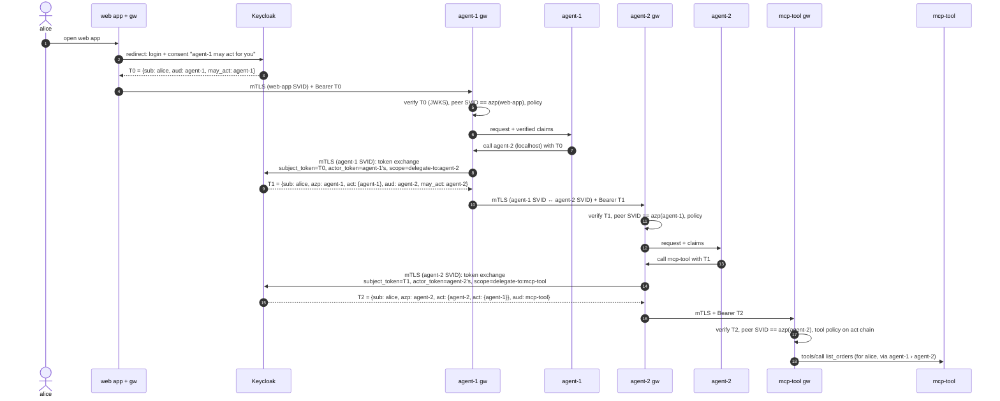

# Agent identity: SPIFFE + Keycloak (RFC 8693) + agentgateway

**Status:** design proposal for review. Nothing in this document is implemented on this branch yet.
**Builds on:** `claude/keycloak-rfc8693-poc` (option C: Keycloak 26.8.1 + `delegation-chain` provider),
which is tested.

---

## 1. What we are solving

Agents call agents, and agents call tools (MCP servers). A request can cross several hops:

```
alice ──► agent-1 ──► agent-2 ──► mcp-tool
```

At **every hop** the receiver must be able to answer three questions, without trusting the caller's
word:

| # | Question | Example answer at mcp-tool |
|---|---|---|
| Q1 | **Which workload is connected to me right now?** | `spiffe://agents.example.com/ns/agents/sa/agent-2` |
| Q2 | **Which user is this work for?** | `alice` |
| Q3 | **Which agents handed the work on, in order?** | `agent-2 › agent-1` |

And then decide: **is this allowed?** (e.g. "alice, via agent-1 then agent-2, may call `list_orders`").

**Non-goals for the first phase:** cross-organisation federation (multiple trust domains), human
approval workflows, LLM-provider traffic.

---

## 2. The core idea: two identities, two jobs, bound together

| | Workload identity | Delegation context |
|---|---|---|
| Answers | Q1: *which software is calling* | Q2 + Q3: *for which user, through which agents* |
| Technology | **SPIFFE** (SPIRE issues X.509-SVIDs) | **OAuth 2.0 Token Exchange, RFC 8693** (Keycloak issues JWTs with `sub` + nested `act`) |
| Carried in | The mTLS connection (client certificate) | The `Authorization: Bearer` header |
| Lifetime | ~1 hour, rotated automatically | Minutes, re-issued at every hop |
| Can it be replayed if stolen? | No: proving it needs the private key | Yes, it's a bearer token, unless bound (below) |

Neither is enough alone:
- SPIFFE alone says "agent-2 is calling" but nothing about alice.
- A token alone says "alice, via agent-1 then agent-2" but anyone holding it could present it.

**The binding (the key control):** the receiver checks that the workload on the mTLS connection is
the client the token was issued to:

```
peer SPIFFE ID  ==  spiffe://agents.example.com/ns/agents/sa/<token.azp>
```

`azp` is the client that received the token from Keycloak, which is the caller on this hop. With
that one rule, a stolen token is useless from any other workload.

---

## 3. Components

| Component | Role | Notes |
|---|---|---|
| **SPIRE server** | Signs SVIDs for the trust domain `agents.example.com` | Chained to a long-lived upstream CA (`UpstreamAuthority`), so other systems can trust one stable root |
| **SPIRE agent** (one per node) | Attests workloads, serves the **Workload API** socket | Kubernetes: `k8s` workload attestor. POC: `docker` attestor |
| **Keycloak 26.8.1** + `delegation-chain` provider | The OAuth authorization server: login, consent, token exchange, nested `act`, audit events | Option C from the POC (tested) |
| **agentgateway sidecar** (one per agent and per tool) | Holds the workload's SVID; terminates and originates mTLS; validates tokens; authorizes; **performs the token exchange**; logs | Same pod as its agent, so it shares the agent's SPIFFE ID |
| **Agent / MCP tool** | Business logic only | Talks plain HTTP to its own sidecar on `localhost`; holds no secrets and no certificates |
| **Web app** | The user-facing front end (OIDC authorization code + PKCE) | Has its own sidecar and SPIFFE ID too |
| **Audit pipeline** | Keycloak events + gateway OpenTelemetry logs and traces, joined on the trace ID | |

---

## 4. Architecture

```mermaid
flowchart LR
  user([alice<br/>browser])
  subgraph spire[SPIRE]
    ss[SPIRE server<br/>trust domain agents.example.com]
    sa[SPIRE agent<br/>Workload API]
  end
  kc[(Keycloak 26.8.1<br/>+ delegation-chain plugin)]

  subgraph podw[web-app pod]
    w[web app] --- gw0[agentgateway]
  end
  subgraph pod1[agent-1 pod]
    a1[agent-1] --- gw1[agentgateway]
  end
  subgraph pod2[agent-2 pod]
    a2[agent-2] --- gw2[agentgateway]
  end
  subgraph podt[mcp-tool pod]
    t[MCP tool] --- gwt[agentgateway]
  end

  user -- OIDC login + consent --> kc
  user -- HTTPS --> w
  gw0 == mTLS + token T0 ==> gw1
  gw1 == mTLS + token T1 ==> gw2
  gw2 == mTLS + token T2 ==> gwt
  gw1 -. mTLS: token exchange .-> kc
  gw2 -. mTLS: token exchange .-> kc
  ss --- sa
  sa -. X.509-SVIDs .-> gw0 & gw1 & gw2 & gwt
```

Legend: thick arrows are agent traffic (always mTLS with SVIDs on both sides); dotted arrows to
Keycloak are the exchanges each caller's gateway makes; dotted arrows from SPIRE are certificate
delivery through the Workload API.

**Where things live:**

| Concern | Lives in |
|---|---|
| Certificates, keys, rotation | SPIRE agent → agentgateway sidecar (never the agent's code) |
| Token validation, authorization, binding check | Receiving sidecar |
| Token exchange | Calling sidecar |
| Who is the user, what is the chain | The token (`sub`, `act`), issued by Keycloak |
| Business decisions ("call agent-2 next") | Agent code |

---

## 5. Request flow, end to end



### What each hop knows and checks

| Hop | mTLS peer (Q1) | `sub` (Q2) | `act` chain (Q3) | Checks at the receiving gateway |
|---|---|---|---|---|
| web app → agent-1 | `…/sa/web-app` | alice | none (alice called directly) | signature, `aud=agent-1`, peer == `azp` (web-app) |
| agent-1 → agent-2 | `…/sa/agent-1` | alice | `agent-1` | signature, `aud=agent-2`, peer == `azp` (agent-1), edge allowed |
| agent-2 → mcp-tool | `…/sa/agent-2` | alice | `agent-2 › agent-1` | signature, `aud=mcp-tool`, peer == `azp` (agent-2), tool + chain policy |

---

## 6. SPIFFE: how and why

### 6.1 What SPIFFE is used for here

1. **mTLS on every hop** (agent ↔ agent, agent ↔ tool, web app → agent). Answers Q1.
2. **Logging in to Keycloak without client secrets.** The calling gateway authenticates to Keycloak's
   token endpoint with its SVID, for the exchange and for the agent's actor token.
3. **Binding tokens to workloads** (section 2). Stops replay of stolen tokens.
4. **Audit.** Every gateway log line carries the peer SPIFFE ID next to `sub` and the `act` chain.

SPIFFE never carries the user. That is always the token's job.

### 6.2 Industry-standard practice we follow

| Practice | Why | Source |
|---|---|---|
| **X.509-SVIDs for service-to-service traffic (mTLS)** | Proof of possession: a certificate can't be replayed without the key. This is how service meshes (Istio, Linkerd, Consul) use SPIFFE | SPIFFE X.509-SVID spec |
| **JWT-SVIDs only where TLS can't be end to end** (an L7 hop that terminates TLS, cloud federation) | JWT-SVIDs are bearer tokens and can be replayed; the SPIFFE JWT-SVID spec says so and recommends short lifetimes and narrow audiences | SPIFFE JWT-SVID spec |
| **Kubernetes-style SPIFFE IDs:** `spiffe://<trust-domain>/ns/<namespace>/sa/<service-account>` | The convention Istio and SPIRE's Kubernetes integrations use; identity follows the pod's service account | Istio, SPIRE Controller Manager |
| **Identity attached to the pod/container by attestation, never configured in the app** | No "secret zero" to distribute | SPIRE |
| **OAuth client authentication with SVIDs, not client secrets** | One identity for both mTLS and OAuth; secretless. X.509 path = RFC 8705 mutual-TLS client auth; JWT path = `client_assertion_type=urn:ietf:params:oauth:client-assertion-type:jwt-spiffe` | RFC 8705; IETF OAuth WG draft `draft-ietf-oauth-spiffe-client-auth` |
| **Exchange the token at every hop, never pass it through** | Each token is addressed to exactly one receiver (`aud`); the MCP authorization spec forbids passing a received token on to another service | RFC 8693; MCP authorization spec |
| **Short-lived everything** | SVIDs ~1 h, exchanged tokens ~5 min | SPIFFE; OAuth best practice (RFC 9700) |

### 6.3 SPIFFE ID scheme

| Workload | SPIFFE ID | Keycloak `client_id` |
|---|---|---|
| web app | `spiffe://agents.example.com/ns/agents/sa/web-app` | `web-app` |
| agent-1 | `spiffe://agents.example.com/ns/agents/sa/agent-1` | `agent-1` |
| agent-2 | `spiffe://agents.example.com/ns/agents/sa/agent-2` | `agent-2` |
| MCP tool | `spiffe://agents.example.com/ns/tools/sa/mcp-tool` | `mcp-tool` |

**Rule:** the last path segment (the service account) equals the Keycloak `client_id`. Policies
compare the two by building the SPIFFE ID from the token's `azp`. (A mapping table works too, at the
cost of keeping it in sync.)

### 6.4 Registration, rotation, trust

- **Registration:** in Kubernetes, the SPIRE Controller Manager registers every pod from a
  `ClusterSPIFFEID` resource (template `ns/{{ .PodMeta.Namespace }}/sa/{{ .PodSpec.ServiceAccountName }}`).
  In the docker-compose POC, `spire-server entry create` with `docker:label:` selectors.
- **The sidecar shares the agent's identity.** In Kubernetes the gateway runs in the agent's pod, so
  SPIRE attests the same service account. The agent process never touches a certificate.
- **Rotation:** automatic. SVIDs live about an hour; the gateway re-reads them from the Workload API.
- **Root of trust:** SPIRE chains to a stable upstream CA. Keycloak's truststore holds that root, so
  SPIRE's own intermediate CA can rotate without touching Keycloak.
- **One trust domain** in phase 1 (agentgateway accepts SVIDs from its own trust domain only; no
  SPIFFE federation).

### 6.5 How a workload authenticates to Keycloak: options

| Option | How | Standard | Keycloak 26.8.1 support | Verdict |
|---|---|---|---|---|
| A. Client secret | `client_secret` in config | RFC 6749 | Stable | **Reject**: secret zero, leaks, manual rotation |
| B. **X.509-SVID over mTLS** | The gateway presents its SVID on the TLS connection to the token endpoint; Keycloak authenticates the client from the certificate | RFC 8705 (`tls_client_auth`); X.509 path of the SPIFFE client-auth draft | Stable (`client-x509`), but matches the certificate's **Subject DN only**, not the SPIFFE ID in the URI SAN. Needs `CN=<client_id>` in the SVID (SPIRE sets the CN from the entry's first DNS name) | **Recommended for phase 1** (matches the cert-based decision) |
| C. JWT-SVID client assertion | `client_assertion_type=…:jwt-spiffe`, `client_assertion=<JWT-SVID>` | JWT path of `draft-ietf-oauth-spiffe-client-auth` | Preview feature `spiffe` (SPIFFE identity provider + `federated-jwt` client authenticator); matches the SPIFFE ID itself | **Watch:** closest to where the standard is going, but preview, and agentgateway can't produce the assertion today |

**Gap to raise upstream:** RFC 8705 defines matching a client on its certificate's URI SAN
(`tls_client_auth_san_uri`), which is exactly the SPIFFE ID. Keycloak's `client-x509` doesn't support
that yet, hence the CN workaround.

---

## 7. agentgateway: what we delegate to it

### 7.1 Responsibilities

| Responsibility | Today (POC) | With agentgateway | agentgateway feature |
|---|---|---|---|
| mTLS, serving and verifying peers | none | Gateway | listener `tls.spiffe`, `backendTLS.spiffe` + `subjectAltNames`, CEL `source.spiffeId` |
| Validate incoming token | Agent (introspection) | Gateway (JWKS, locally) | `jwtAuth` / `mcpAuthentication` (provider `keycloak`) |
| Authorization (edges, tools, binding) | none | Gateway | `authorization` / `mcpAuthorization` CEL rules |
| RFC 8693 exchange | Agent | **Gateway (egress)** | `backendAuth.oauthTokenExchange` with `actorToken`, `scopes`, cache keyed on subject + actor |
| Authenticate to Keycloak | Agent, client secret | **Gateway, SVID over mTLS** | `oauthTokenExchange.policies.backendTLS` (to verify, section 11) |
| Get the agent's actor token | Agent, client secret | Agent asks its gateway; gateway calls Keycloak with the SVID | a route to Keycloak's token endpoint with `backendTLS` (to verify) |
| Strip the actor token before forwarding | n/a | Gateway | `requestHeaderModifier.remove` |
| Audit logs, traces | Agent `print` | Gateway | OpenTelemetry logs + traces |
| Business logic, choosing the next hop | Agent | Agent | n/a |

**What the agent still does:** call `http://localhost:<gw>/to/agent-2` with the token it received and
its actor token. That's one Keycloak call through its own gateway, cached until it expires. agentgateway reads the
actor token from a request header, cookie, query parameter or CEL expression; it has no option to
fetch it itself.

### 7.2 Sidecar configuration sketch (agent-1)

Illustrative only; field names come from agentgateway's config schema, but the combination is
unverified (section 11).

```yaml
config:
  spiffe:
    endpoint: unix:///run/spire/agent.sock          # SPIRE Workload API

binds:
# Inbound: other workloads call agent-1 here
- port: 8443
  listeners:
  - name: inbound
    protocol: HTTPS
    tls:
      spiffe: {}                                     # serve agent-1's SVID, require client SVIDs
    routes:
    - name: to-agent-1
      policies:
        jwtAuth:
          issuer: https://kc.example.com/realms/agents
          audiences: [agent-1]
          jwks: { url: https://kc.example.com/realms/agents/protocol/openid-connect/certs }
        authorization:
          rules:
          # binding: the connected workload is the client the token was issued to
          - 'source.spiffeId == "spiffe://agents.example.com/ns/agents/sa/" + jwt.azp'
          # who may call agent-1 at all
          - 'jwt.azp in ["web-app"]'
      backends:
      - host: localhost:8081                         # agent-1's own process

# Outbound: agent-1 calls agent-2 through here
- port: 15001
  listeners:
  - name: to-agent-2
    protocol: HTTP                                   # localhost only
    routes:
    - name: to-agent-2
      backends:
      - host: agent-2.agents.svc:8443
        policies:
          backendTLS:
            spiffe: {}
            subjectAltNames: [spiffe://agents.example.com/ns/agents/sa/agent-2]
          backendAuth:
            oauthTokenExchange:
              host: kc.example.com:443
              path: /realms/agents/protocol/openid-connect/token
              scopes: [delegate-to:agent-2]
              actorToken:
                source: { header: { name: x-actor-token } }
              # client authentication by SVID over mTLS instead of a secret (to verify):
              policies:
                backendTLS: { spiffe: {} }
              additionalParams:
                client_id: '"agent-1"'
          requestHeaderModifier:
            remove: [x-actor-token]
```

### 7.3 Policy examples (receiving side)

At agent-2: "only agent-1 may call me, and only on a user's behalf":
```
source.spiffeId == "spiffe://agents.example.com/ns/agents/sa/" + jwt.azp
&& jwt.azp == "agent-1" && jwt.act.client_id == "agent-1"
```

At the MCP tool: "`list_orders` only for requests that came agent-1 → agent-2":
```
mcp.tool.name == "list_orders"
&& source.spiffeId == "spiffe://agents.example.com/ns/agents/sa/agent-2"
&& jwt.act.client_id == "agent-2" && jwt.act.act.client_id == "agent-1"
```

Use `allow`/`require` rules, not `deny` (agentgateway warns that a deny expression that errors does
not deny).

---

## 8. Keycloak configuration (unchanged from option C, plus SVID login)

| Item | Setting |
|---|---|
| Features | `token-exchange-delegation`, `parameterized-scopes` (both preview in 26.8) |
| Provider | `delegation-chain` jar (nests the subject token's `act`) |
| User-facing delegation | Built-in `delegation:client:<agent>` scope with consent, on `web-app` |
| Agent-to-agent delegation | `delegate-to:<client>` scope (copy of the built-in, no always-consent), optional on each agent |
| Who may be delegated to | FGAP v2 `delegate` permission on Users, for the agent clients |
| Agent client authentication | `client-x509`, `x509.subjectdn` regex `(.*?)CN=<client_id>(?:,.*)?$` |
| HTTPS | `https-client-auth=request`, truststore = SPIRE's upstream root |
| Do **not** enable | RFC 8705 certificate-bound access tokens for agents: Keycloak then refuses the next hop's exchange (the subject token wasn't issued to the requester) |
| Audit | Event storage on (or streamed to the SIEM); TOKEN_EXCHANGE events carry user, client, actor, audience, and the reason on refusal |

---

## 9. Threats and how the design answers them

| Threat | Answer |
|---|---|
| Stolen token replayed from another workload | Binding rule: peer SPIFFE ID must match `azp` |
| Stolen token sent to a different service | `aud` is exactly one receiver per hop |
| Agent skips a hop or calls a service it shouldn't | Edge rules at the receiver (`jwt.azp in [...]`), chain rules at tools |
| Agent asks Keycloak to delegate to itself or the wrong target | Keycloak: `may_act` must name the requester; FGAP `delegate` controls targets |
| Workload impersonates another agent | SPIRE attestation; SVID needed for mTLS and for Keycloak login |
| Leaked client secret | There are none |
| Compromised gateway sidecar | Same blast radius as the agent it serves (same pod, same identity); can't act for other agents |
| Confused deputy at the MCP tool | The tool sees the full chain and the user, and decides on them |
| Tampered chain | `act` is inside a Keycloak-signed token |
| Long-lived credentials | SVIDs ~1 h, tokens ~5 min, both rotated automatically |

---

## 10. Design decisions

| # | Decision | Recommendation | Alternatives | Status |
|---|---|---|---|---|
| D1 | Gateway placement | **Sidecar per agent and tool** (mesh pattern: identity per workload) | One central gateway: simpler to run, but it must hold every agent's identity and the binding becomes "gateway ↔ gateway" | Proposed |
| D2 | Workload credential on the wire | **X.509-SVID, mTLS on every hop** | JWT-SVID in a header: replayable | Proposed |
| D3 | Workload → Keycloak authentication | **X.509-SVID over mTLS (`client-x509`, CN mapping)** | JWT-SVID assertion (preview in Keycloak, not producible by agentgateway today); client secret (rejected) | Proposed, needs spike S1/S2 |
| D4 | User + chain context | **RFC 8693 nested `act` via Keycloak + `delegation-chain` provider (option C)** | Option B (no plugin, chain in logs only); OAuth Transaction Tokens (IETF draft, see below) | Decided earlier |
| D5 | Token ↔ workload binding | **Gateway rule: peer SPIFFE ID == `azp`** | RFC 8705 cert-bound tokens: incompatible with Keycloak's exchange of a token issued to someone else | Proposed |
| D6 | Authorization engine | **agentgateway CEL** for edges, tools and chain rules | OPA (via external authorization) when policies outgrow CEL | Proposed |
| D7 | SPIFFE ID format | **`ns/<namespace>/sa/<service-account>`**, service account = Keycloak `client_id` | Custom paths plus a mapping table | Proposed |
| D8 | Trust domains | **One** (`agents.example.com`) in phase 1 | Federation later; agentgateway doesn't support it today | Proposed |
| D9 | Token validation | **Local (JWKS) at the gateway**; introspection only for high-risk tools | Introspection everywhere: catches logout instantly, adds latency and a hard Keycloak dependency | Proposed |

### Where the standards are heading

| Standard | Status (Nov 2026) | Relevance |
|---|---|---|
| RFC 8693 OAuth Token Exchange | RFC | Our delegation mechanism |
| RFC 8705 OAuth mutual-TLS client auth | RFC | Our Keycloak login with X.509-SVIDs |
| SPIFFE ID / X.509-SVID / JWT-SVID / Workload API | CNCF specs (graduated project) | Workload identity |
| `draft-ietf-oauth-spiffe-client-auth` | IETF OAuth WG draft | SVIDs as OAuth client credentials (X.509 via RFC 8705; JWT via `jwt-spiffe`) |
| IETF WIMSE architecture (`draft-ietf-wimse-arch`) | Working group draft | Reference model for workload identity across systems; describes carrying request context as transaction tokens |
| OAuth Transaction Tokens (`draft-ietf-oauth-transaction-tokens`) | Draft | Alternative way to propagate user + context inside one trust domain. Revisit when it's an RFC and has implementations |
| MCP authorization spec | Published spec | Tokens per resource (audience), no token passthrough |

---

## 11. Unknowns to settle before implementing (spikes)

| # | Question | Why it matters | How to settle |
|---|---|---|---|
| S1 | Can agentgateway present its SVID on the connection to Keycloak (`oauthTokenExchange.policies.backendTLS`) while trusting Keycloak's server certificate? `backendTLS.spiffe` takes trust roots from the SPIFFE bundle, so Keycloak's server cert would have to chain to SPIRE; otherwise use `cert`/`key`/`root` files written by spiffe-helper | Secretless Keycloak login from the gateway (D3) | Small compose test |
| S2 | Does Keycloak `client-x509` accept an SPIRE X.509-SVID with `CN=<client_id>`, and does `additionalParams.client_id` get it the `client_id` it needs? | D3 | Same test, Keycloak logs |
| S3 | Does `backendAuth` read `x-actor-token` before `requestHeaderModifier` removes it? | The agent's actor token must not leak to the next hop | Echo upstream |
| S4 | CEL: `source.spiffeId` and nested `jwt.act.act.client_id` in `authorization` and `mcpAuthorization` | Binding and chain rules (sections 7.3) | Unit test with crafted tokens |
| S5 | Actor token: is there any way for agentgateway to obtain it itself (e.g. an external-auth callout)? | Would remove the last Keycloak-related step from agent code | Read agentgateway source / ask maintainers |
| S6 | SPIRE docker attestor + compose network setup so a sidecar shares its agent's identity | POC only (Kubernetes does this natively) | Compose test |
| S7 | Does Keycloak evaluate the FGAP `delegate` permission for the user when `delegate-to:<next>` is requested during an exchange (not only at login)? Can the permission target a group of users? | Per-user chain control at issuance (13.3) | Remove one agent from the permission and run the chain |

---

## 12. Implementation plan (this branch)

| Phase | Deliverable | Done when |
|---|---|---|
| 0 | Spikes S1–S6 | Each answered, design updated |
| 1 | SPIRE server + agent in docker-compose; entries for web-app, agents, tool, gateways | `spire-server entry show` lists them; gateways fetch SVIDs |
| 2 | agentgateway sidecars with mTLS on every hop (no token changes yet) | Chain works; a client without an SVID is refused |
| 3 | Keycloak login with SVIDs (`client-x509`), secrets removed | No `client_secret` anywhere in the repo |
| 4 | Token exchange moved into the calling sidecar; agents only attach `x-actor-token` | Full `act` chain reaches the tool; agent code has no exchange logic |
| 5 | Validation + authorization + binding rules at every receiving sidecar; MCP tool behind `mcpAuthentication` / `mcpAuthorization` | Policy tests below pass |
| 6 | Audit: Keycloak events + gateway OTel logs/traces with SPIFFE ID, `sub`, `act` | One request reconstructed end to end from the logs |

**Tests:**
1. Happy path: the tool sees `sub=alice`, `act = agent-2 › agent-1`, peer `…/sa/agent-2`.
2. A workload without an SVID can't connect, and can't get a Keycloak token.
3. agent-2's token replayed from another workload is refused (binding).
4. An agent calling a target its edge rules don't allow is refused.
5. A chain the tool policy doesn't allow (e.g. agent-3 → tool directly) is refused.
6. Keycloak refuses an exchange whose actor isn't named in `may_act`.
7. The actor token never reaches the next hop.

---

## 13. Who can do what, and registering workloads

Four questions, each answered in layers: **Keycloak decides what tokens get issued**, and the
**receiving gateway enforces at runtime**. A request has to pass both.

### 13.1 Which user can access which workload (agent)?

**Model:** one Keycloak group per agent, e.g. `agent-1-users`. Membership = "this user may use agent-1".

| Layer | Check | How |
|---|---|---|
| Keycloak, at login | May agent-1 act for this user? | The user requests `delegation:client:agent-1` and consents. Keycloak evaluates the FGAP `delegate` permission: agent-1's service account must be allowed to delegate for this user. The permission can name specific users or all users |
| Keycloak, optional hard block | Can this user log in to the front end at all? | Built-in authentication flow: *Condition - user role* + *Deny access* |
| agent-1's gateway, every request | Is the user in `agent-1-users`? | `authorization` rule `"agent-1-users" in jwt.groups`. Needs a *Group Membership* mapper in a default client scope on every agent client, so the claim survives each exchange |

Groups rather than roles: our agent clients have `fullScopeAllowed` off, which filters roles out of
tokens; group membership mappers aren't affected by that.

### 13.2 Which workload can access which tool?

| Layer | Check | How |
|---|---|---|
| Connection (SPIFFE) | Which workloads may connect to the tool at all? | Tool gateway rule `source.spiffeId in [".../sa/agent-2", ...]` |
| Caller's egress | Can agent-2 even reach the tool? | Only workloads with an egress route to the tool can call it; the route also pins the tool's SPIFFE ID (`backendTLS.subjectAltNames`) |
| Keycloak, at exchange | Can a token for the tool be issued? | The tool must be a valid delegation target: a client with a service account, covered by the FGAP `delegate` permission. **Gap:** Keycloak can't say "agent-2 may request `delegate-to:mcp-tool` but agent-3 may not"; the scope is granted per client, not per caller/target pair. So pair rules live in the gateway |
| Tool gateway, per tool | Which agent may call which tool? | `mcpAuthorization` rule, e.g. `mcp.tool.name == "list_orders" && jwt.azp == "agent-2"` |

### 13.3 Is this delegation chain allowed for this user?

| Layer | Check | How |
|---|---|---|
| Keycloak, each link | May the next agent act for this user? | First link: the user's consent. Every later link: when agent-N requests `delegate-to:agent-N+1`, Keycloak evaluates the FGAP `delegate` permission of agent-N+1 against this user (spike S7: confirm it runs at exchange time) |
| Every receiving gateway | Is the user allowed through this exact path? | CEL over `sub`/groups and the `act` chain, e.g. at the tool: `"finance" in jwt.groups && jwt.act.client_id == "agent-2" && jwt.act.act.client_id == "agent-1"` |
| Every receiving gateway | Is the chain too long? | e.g. `!has(jwt.act.act.act)` (at most 2 agents before the tool) |

**Phase 1:** CEL rules generated from one access matrix. **When the matrix grows** (many users ×
agents × tools), move the decision to OPA with the matrix as data, called through agentgateway's
external authorization.

Example matrix (the single source the rules are generated from):

| User group | May use agent | Allowed chains | Tools at the end |
|---|---|---|---|
| `finance` | agent-1 | agent-1 → agent-2 → mcp-tool | `list_orders`, `get_invoice` |
| `support` | agent-1 | agent-1 → mcp-tool | `get_user` |
| everyone else | none | none | none |

### 13.4 How do we register a workload?

Registering an agent or tool creates **three linked records**, which must agree on one name
(the service account name, e.g. `agent-3`):

| # | Record | Where | What |
|---|---|---|---|
| 1 | **Workload identity** | SPIRE | Kubernetes: automatic, from a `ClusterSPIFFEID` (`spiffe://agents.example.com/ns/<ns>/sa/<sa>`); the pod's namespace and service account are the attestation selectors. Also set a DNS name = `<sa>` so the SVID's CN is the Keycloak `client_id` (D3). POC: `spire-server entry create -spiffeID … -selector docker:label:… -dns agent-3` |
| 2 | **OAuth client** | Keycloak | `client_id = <sa>`; confidential; client authenticator `client-x509` with `x509.subjectdn` `(.*?)CN=agent-3(?:,.*)?$`; service account on; `standard.token.exchange.enabled`; optional scope `delegate-to`; group-membership mapper scope; add to the FGAP `delegate` permission if others may delegate to it; group `agent-3-users` |
| 3 | **Policy + sidecar** | agentgateway config | Inbound rules (who may call it, which users), egress routes (which targets it may call, pinned SPIFFE IDs, exchange settings), tool rules for MCP servers |

**Process:**
1. The team submits one **workload manifest** (below) by pull request.
2. **Security reviews and approves it.** Registration is security-critical: whoever can register
   `CN=agent-1` or the `agent-1` service account can act as agent-1.
3. A pipeline applies it: SPIRE (ClusterSPIFFEID / entries), Keycloak (admin API, Terraform's
   Keycloak provider or keycloak-config-cli), and the gateway config.
4. A smoke test proves the workload gets an SVID, logs in to Keycloak with it, and is refused
   everywhere the matrix doesn't allow it.

```yaml
# workloads/agent-3.yaml (illustrative)
name: agent-3                     # service account = Keycloak client_id = SVID CN
namespace: agents
kind: agent                       # agent | tool
owner: team-payments
users: [finance]                  # groups allowed to use it      → 13.1
calls: [mcp-tool]                 # targets it may call           → egress routes, 13.2
callers: [agent-1]                # who may call it               → inbound rules
delegation_target: true           # may others delegate to it     → FGAP delegate
tools: {}                         # for kind: tool, per-tool rules → mcpAuthorization
```

**Deregistration** reverses all three, so a removed agent can't get an SVID, can't log in to
Keycloak, and can't be reached.

## 14. References

- RFC 8693 OAuth 2.0 Token Exchange: https://www.rfc-editor.org/rfc/rfc8693
- RFC 8705 OAuth 2.0 Mutual-TLS Client Authentication: https://www.rfc-editor.org/rfc/rfc8705
- SPIFFE specifications: https://github.com/spiffe/spiffe/tree/main/standards
- OAuth SPIFFE Client Authentication (IETF draft): https://datatracker.ietf.org/doc/draft-ietf-oauth-spiffe-client-auth/
- WIMSE architecture (IETF draft): https://datatracker.ietf.org/doc/draft-ietf-wimse-arch/
- OAuth Transaction Tokens (IETF draft): https://datatracker.ietf.org/doc/draft-ietf-oauth-transaction-tokens/
- agentgateway: https://github.com/agentgateway/agentgateway (examples `traffic-spiffe`, `traffic-token-exchange`, `mcp-authorization`)
- Keycloak 26.8.1 source: `TokenExchangeDelegationProvider`, `X509ClientAuthenticator`, `broker/spiffe`
- This repo: `claude/keycloak-rfc8693-poc` (option C, tested), `claude/gateway-kong-ai` (Kong, stand-in tested)
